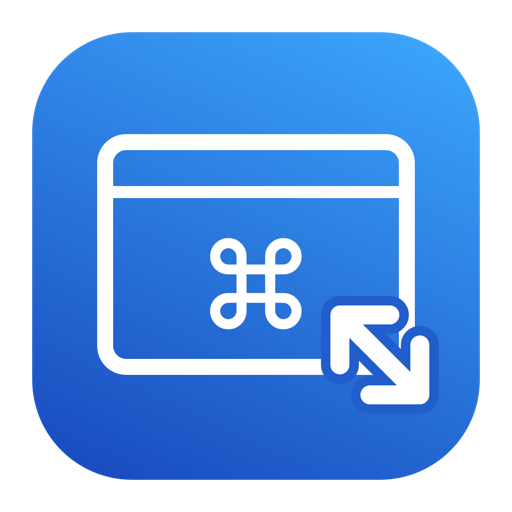
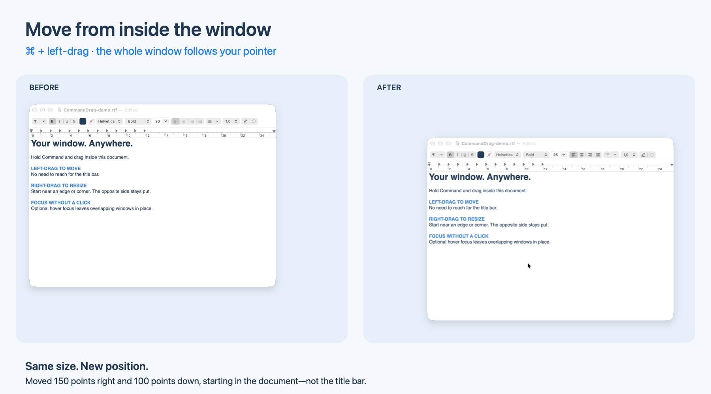
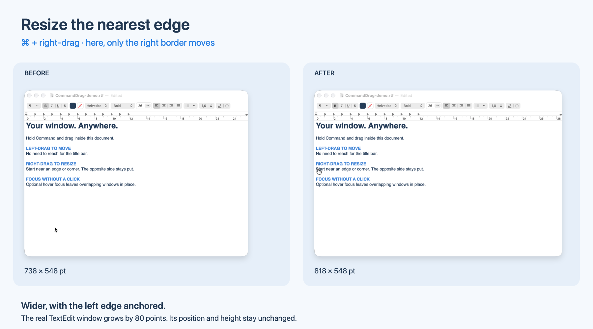

<p align="center">
  
</p>

<h1 align="center">CommandDrag</h1>

<p align="center">
  <a href="https://github.com/penso/CommandDrag/actions/workflows/ci.yml"></a>
</p>

<p align="center">
  <b>Move, resize, and focus windows with your mouse—without reaching for the title bar.</b>
</p>

<p align="center">
  <a href="#screenshots">Screenshots</a> ·
  <a href="#install">Install</a> ·
  <a href="https://github.com/penso/CommandDrag/releases">Releases</a> ·
  <a href="#gestures">Gestures</a> ·
  <a href="#focus-follows-mouse">Hover focus</a> ·
  <a href="#troubleshooting">Troubleshooting</a> ·
  <a href="#development">Development</a> ·
  <a href="LICENSE">MIT license</a>
</p>

A lightweight, native Objective-C menu-bar app for **macOS 13 and later**. Hold Command and drag inside a window to move it or resize the nearest edge. Enable **focus follows mouse** for Linux-style keyboard focus on hover, without clicking or raising the window.

- **⌘ + left-drag** to move a window, including background windows.
- **⌘ + right-drag** to resize the nearest border or corner.
- **Hover to focus, without raising:** rest the pointer over a window to send keyboard input there while keeping overlapping windows in place. Optional; no click or modifier needed.
- Menu-bar controls for pause/resume, modifier selection, and launch at login.
- Native Objective-C, no third-party runtime dependencies, and no network access.

## Screenshots

Real TextEdit window captures, arranged side by side with labels. The surrounding desktop is omitted.

<p align="center">
  
  <br>
  <sub><b>Move from the content area.</b> Hold Command and left-drag wherever your pointer already is.</sub>
</p>

<p align="center">
  
  <br>
  <sub><b>Resize a border, not just the bottom-right corner.</b> The drag's starting region selects which edges move.</sub>
</p>

## Install

Download the **universal DMG for Apple Silicon and Intel** from [GitHub Releases](https://github.com/penso/CommandDrag/releases/latest).

1. Open `CommandDrag-vX.Y.Z-universal.dmg`.
2. **Drag CommandDrag onto the Applications shortcut** in the installer window.
3. Eject the disk image, then open **CommandDrag from Applications**.
4. Grant Accessibility permission as described below.

When updating, quit the running copy before replacing it. The app and DMG are **Developer ID signed and notarized by Apple**. A ZIP download is also available if you prefer to copy the app manually.

### Build from source

Requires **macOS 13+** and **Xcode Command Line Tools**. Install the tools if needed:

```sh
xcode-select --install
```

Clone and build:

```sh
git clone https://github.com/penso/CommandDrag.git
cd CommandDrag
bash build.sh
ditto build/CommandDrag.app /Applications/CommandDrag.app
open /Applications/CommandDrag.app
```

The app appears as **↔** in the menu bar, without a Dock icon. Keep it in `/Applications` before granting permissions or enabling launch at login.

### First launch

1. Grant **CommandDrag** access in **System Settings → Privacy & Security → Accessibility**. The app opens this pane on first launch.
2. If the menu still reports a permission problem, use **Open Input Monitoring…**, enable CommandDrag there, and quit and reopen it. macOS permission behavior varies by version; an active event tap may work with Accessibility permission alone.
3. The menu should say **Ready**. Turn on **Launch at Login** if desired; approve it in System Settings if macOS asks.
4. For keyboard focus on hover, enable **Focus Follows Mouse (Without Raising)** in the **↔** menu. This is off by default.

## Gestures

| Gesture | Behavior |
| --- | --- |
| Hold Command, then left-drag a window | Move from anywhere in its accessible content |
| Hold Command, then right-drag a window | Resize the border or corner nearest the drag's starting point |
| Hover over a window for 180 ms, with hover focus enabled | Give it keyboard focus without clicking or raising it |
| Release the mouse button | End the gesture, even if Command was released first |

### Resize from any side

Where you start the right-drag determines which edges move. Imagine the window divided into thirds:

| ↖ Top-left corner | ↑ Top edge | ↗ Top-right corner |
| :---: | :---: | :---: |
| **← Left edge** | **Nearest edge** | **Right edge →** |
| **↙ Bottom-left corner** | **↓ Bottom edge** | **↘ Bottom-right corner** |

The selected edges stay the same throughout the drag. The opposite edge or corner stays anchored: drag outward to grow, inward to shrink. Windows retain their app's size constraints, with a requested minimum of 120 × 80 points on the resized axes.

### Make it yours

- Choose **Modifier → Option or Control** if Command conflicts with your workflow. The choice persists.
- Use **Pause** when you need the modifier's normal click behavior.
- Enable **Launch at Login** to keep CommandDrag available after signing in.

Use only the selected modifier; extra Command/Option/Control/Shift keys bypass the gesture. Normal clicks pass through while paused or over unsupported windows. An accepted drag won't activate links, select text, or open a context menu. You can move and resize background windows without activating their app.

## Focus follows mouse

**Point at a window, then type—no click required.** Like Linux's focus-follows-mouse mode, keyboard focus follows your pointer while the window stacking order stays in place.

1. Open CommandDrag's **↔** menu.
2. Enable **Focus Follows Mouse (Without Raising)**.
3. Rest the pointer over the visible part of a window for **180 ms**, then type into its previously focused control.

For example, hover over the exposed portion of a terminal behind your editor. The terminal receives keyboard input while the editor remains in front of it. Hovering changes which window receives input; it does not click a field or reposition the text cursor.

The setting is **off by default** and persists across launches. It works across apps and between windows of the same app. The short delay avoids switching focus whenever you merely cross another window. Turn it off from the same menu to return to normal click-to-focus behavior.

Hover focus is suspended while paused, holding Command/Option/Control/Shift, or dragging with a mouse button. Desktop, menu, and nonstandard window elements are skipped. It does not click the hovered content.

macOS has no public API for this Linux-style focus behavior. The implementation uses the private SkyLight focus protocol also used by yabai. These APIs are resolved at runtime; if unavailable, the menu says **Hover Focus Unavailable**. There is no raise-based fallback. Compatibility may vary with macOS versions and individual apps; an app may choose to raise its own windows in response to activation.

## Troubleshooting

| Symptom | What to check |
| --- | --- |
| Drags do nothing | Check **Accessibility** permission for the installed app and look for **Ready** in its menu. |
| The menu reports an Input Monitoring problem | Use **Open Input Monitoring…**, enable CommandDrag, then quit and reopen it. |
| It stopped working after rebuilding | Quit, remove the old Accessibility entry, add `/Applications/CommandDrag.app` again, and reopen. Ad-hoc signatures can invalidate approval after an update. |
| A particular window won't move or resize | Its app must expose the relevant Accessibility capability. Full-screen windows are skipped. |
| Hover focus is unavailable | The private focus APIs aren't available on this macOS version. Moving and resizing remain independent of them. |

### Compatibility and privacy

- Some apps do not expose accessible windows or support setting their position/size. Full-screen windows are skipped. Secure system UI and locked sessions are outside the app's control.
- The selected modifier's normal click behavior is replaced over supported windows. Pause from the menu when you need that behavior, or select a different modifier.
- Rebuilding an ad-hoc signed app can invalidate its Accessibility approval. If it stops working after an update, quit it, remove its entry in Privacy & Security, add the installed copy again, and reopen it.
- Launch at login uses `SMAppService` (macOS 13+). Disable it before moving or deleting the app.
- The app receives global mouse events to recognize gestures. It has no network, analytics, or event logging code.

The default build is locally ad-hoc signed. For distribution, use a Developer ID identity (`SIGN_IDENTITY="Developer ID Application: …" bash build.sh`) and Apple's notarization process. This source package is not a notarized binary.

### Update or uninstall

To update, quit CommandDrag, run `git pull` and `bash build.sh` in your checkout, then copy the new bundle to `/Applications` and reopen it using the install commands above.

To uninstall, disable **Launch at Login**, quit CommandDrag, delete `/Applications/CommandDrag.app`, and remove its Privacy & Security entries.

## Development

Moving and resizing use public Accessibility and Quartz event-tap APIs. Window lookup happens once per gesture; subsequent events update that window directly. Accessibility calls have a short timeout, and failed updates cancel manipulation while consuming the remainder of the drag.

Hover focus uses a one-shot timer, with lookup and focus outside the event-tap callback. There is no continuous hover polling. A low-frequency, coalescible timer checks permissions. No third-party runtime dependencies, SIP changes, or code injection are required.

### Build checks

Build with `bash build.sh` (compiler warnings are treated as errors). To check the bundle and its signature:

```sh
plutil -lint Sources/Info.plist
codesign --verify --strict --verbose=2 build/CommandDrag.app
```

The default build includes **arm64 and x86_64**. For a native-only development build, set `ARCHS=arm64` or `ARCHS=x86_64`.

### CI and releases

[CI](https://github.com/penso/CommandDrag/actions/workflows/ci.yml) checks scripts, metadata, and static analysis, then builds and verifies a universal app. Its downloadable artifacts are ad-hoc signed development builds.

Workflow changes are gated by **zizmor**. Packaging dependencies are hash-locked and audited for vulnerabilities, including on a weekly schedule. External GitHub Actions are pinned to full commit SHAs, and release signing requires green CI for the exact source commit.

Tags such as `v1.0.1` trigger the [release workflow](.github/workflows/release.yml): Developer ID signing, Apple notarization, ticket stapling, and a GitHub Release with a drag-to-install DMG, a universal ZIP, and SHA-256 checksums. See [the release guide](docs/releases.md) for credential setup, local DMG packaging, and publishing instructions.

The hardened release pipeline also publishes **Sigstore signatures, GitHub build provenance, a CycloneDX SBOM, and SHA-512 checksums**. See [verifying downloads](docs/verification.md) for verification commands and which releases include them.

<details>
<summary>Manual verification checklist</summary>

After installing and granting Accessibility permission:

1. Move a Finder and TextEdit window by dragging in their content while holding Command. Verify ordinary clicks and text selection still work without it.
2. Command-right-drag from each corner and each side region. Verify only the selected borders move, opposite borders stay fixed, app minimum sizes are respected (especially while shrinking from the left/top), and no context menu appears. Try the center region too: it should select the nearest border. Right-click without Command should still open the normal menu.
3. Release Command before the mouse button during each gesture. Verify dragging ends on mouse-up and subsequent clicks work normally.
4. Try a background window and a window on another display, including one above or left of the main display.
5. Verify full-screen windows are ignored. Confirm unsupported resize operations pass through.
6. Pause/resume; switch modifiers; quit/reopen to check the saved selection.
7. Enable launch at login, sign out/in, and check the app returns. Disable it and verify the setting clears.
8. Revoke Accessibility access and verify the permission status updates; restore it and relaunch if needed.
9. Enable hover focus and arrange overlapping windows from different apps. Hover over the exposed part of the rear window, then type into an already focused text field: keyboard input should switch while the window order remains unchanged. Repeat with two windows of the same app. Check that merely crossing a window, holding a modifier, and dragging do not switch focus. Disable hover focus and verify click-to-focus behavior returns.

</details>

### Source layout

- `Sources/main.m`: menu, preferences, permissions, login item, hit-testing, and mouse handling.
- `Sources/Focus.h`, `Sources/Focus.m`: dynamically resolved focus-without-raising support.
- `Sources/Info.plist`: app bundle metadata.
- `Sources/CommandDrag.icns`: app icon for Finder and System Settings.
- `Scripts/generate-icon.m`: native, reproducible icon artwork generator.
- `assets/commanddrag.png`: PNG version of the app icon for this README.
- `build.sh`: compile and sign a local app bundle.

To regenerate the icon (the normal build uses the checked-in icon):

```sh
mkdir -p build
xcrun clang -fobjc-arc -Wall -Wextra -Werror -O2 -framework Cocoa Scripts/generate-icon.m -o build/generate-icon
build/generate-icon
iconutil -c icns build/CommandDrag.iconset -o Sources/CommandDrag.icns
cp build/CommandDrag.iconset/icon_256x256@2x.png assets/commanddrag.png
bash build.sh
```

## License

[MIT](LICENSE) © 2026 Fabien Penso.

The focus-without-raising protocol is adapted from [yabai](https://github.com/koekeishiya/yabai), also MIT-licensed. See [third-party notices](THIRD_PARTY_NOTICES.md) for attribution and license terms.
